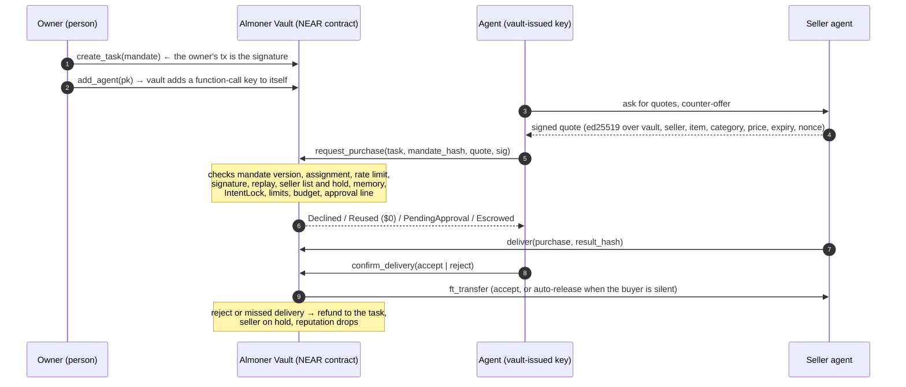

# Almoner on NEAR

**Every agent purchase, accounted for, and enforced by a NEAR contract.**

AI agents now buy data, APIs and compute by themselves, a few cents at a time. A spending cap answers "can the agent afford this?". It doesn't answer "is this what the agent was asked to buy, did we pay what was quoted, did we get what we paid for, and can we prove it?" Almoner answers those questions in a NEAR contract that the agent can't get around.

## Tracks

| Track | Official ask (nearhackathon.com) | Where Almoner does it |
| --- | --- | --- |
| **`security`** AI Security & Defense (primary) | "Spending limits, policy engines, sandboxed wallets, reputation and scam detection. Give AI money without handing it the keys to everything." Hints: agent security, function-call keys | Per-task budgets, per-purchase caps and approval lines (`decide()` in `contracts/vault/src/lib.rs`); the vault is the sandboxed wallet and issues **function-call keys** that can only ask (`add_agent`); IntentLock refuses off-purpose and disguised purchases; signed quotes stop price and payee tampering; sellers who don't deliver go on hold |
| **`agents`** Agent Economy | "Agents that earn, spend, negotiate, hire other agents, and pay for APIs, compute or data" | Buyer agents **spend** from the vault and **negotiate** with seller agents (`ts/src/agent.ts`); seller agents **earn** through escrow and build reputation from verified deliveries (`ts/src/sellers.ts`, `get_sellers`); every purchase is data paid per call |

Built from scratch at NEAR HACKATHON, Nov 2026. NEAR is the core: see [Why NEAR, specifically](#why-near-specifically).

---

## What it does in one picture

